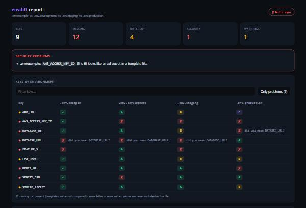

# envdiff

[](https://www.npmjs.com/package/@guihakka2/envdiff) [](https://github.com/Guihakka2/envdiff/actions/workflows/ci.yml)

English · [Português](README.pt-BR.md) · [日本語](README.ja.md)

Compare `.env` files across environments (dev, staging, prod, `.env.example`) — **without ever printing secret values**.

Safe to run in CI logs, screenshots and pull requests: values are compared in memory, only key names are shown.

<p align="center"></p>

```bash
npx @guihakka2/envdiff            # compares .env.example with .env in this folder
npx @guihakka2/envdiff .env .env.example --keys-only
npx @guihakka2/envdiff .env.staging .env.production
```

```
envdiff  .env.staging  vs  .env.production

Missing in .env.production:
  - REDIS_URL

Different values (hidden):
  ~ DATABASE_URL

Possible real secrets in template files:
  ! .env.example: AWS_ACCESS_KEY_ID (line 3)

✗ Not in sync
```

## Features

- Missing / extra keys across **2 or more** files
- Changed values, shown only as key names
- Detects real-looking secrets (AWS, GitHub, GitLab, npm, OpenAI, Stripe, Slack, Google, Azure, JWT, private keys) committed in `.example` / `.sample` / `.template` files
- Duplicate keys, empty values, malformed lines
- **Git safety**: fails if a real `.env` is committed to git, warns if it is not in `.gitignore`
- **Did you mean?** hints for typos like `DATABSE_URL`
- `--json` output and exit codes for CI: `0` in sync, `1` differences, `2` usage error
- Zero dependencies, runs offline, nothing is sent anywhere

## Use in CI (GitHub Actions)

```yaml
- uses: Guihakka2/envdiff@v1
  with:
    files: .env.example .env.ci   # empty = .env.example vs .env
    args: --keys-only --strict
```

The report (key names only) is also written to the job summary. Needs Node 20+ on the runner (GitHub-hosted runners have it). Pin to a commit SHA for maximum supply-chain safety.

Or without the action: `npx @guihakka2/envdiff .env.example .env.ci --keys-only`

## Visual report

```bash
npx @guihakka2/envdiff .env.example .env.development .env.staging .env.production --html report.html
```

<p align="center"></p>

One self-contained HTML file (dark and light mode, works offline, filter + "only problems"). Like the terminal output, it **never contains values**, so it is safe to attach to CI runs or share with your team.

## Options

| Flag | What it does |
|---|---|
| `--keys-only` | Compare key names only (use with `.env.example`) |
| `--ignore LIST` | Skip keys expected to differ, comma-separated, `*` wildcard: `--ignore APP_URL,DEBUG_*`. Can repeat. Leaked secrets are still reported. |
| `--strict` | Warnings (duplicate key, empty value, invalid line) also fail with exit code 1 |
| `--table` | Grid of keys × files: `✗` missing, same letter = same value (values never shown) |
| `--fix` | Appends missing keys with **empty** values to the files that lack them. Never copies values, never edits existing lines. |
| `--html FILE` | Also writes a visual HTML report (never contains values) |
| `--json` | Machine-readable report (never contains values) |
| `-h`, `--help` | Help |
| `-v`, `--version` | Version |

## Parsing

Follows common dotenv rules: `export` prefix, `#` comments, single/double/backtick quotes, multiline quoted values (e.g. private keys), and `\"` `\n` `\t` `\\` escapes inside double quotes. An unclosed quote is reported as an invalid line instead of swallowing the rest of the file. No variable expansion (`${VAR}`) yet.

## Alternatives

Good tools already exist; pick the one that fits:

- [dotenv-linter](https://github.com/dotenv-linter/dotenv-linter) (Rust) — lints and auto-fixes `.env` files, and has a command to compare key sets between files.
- [dotenv-diff](https://github.com/Chrilleweb/dotenv-diff) (Node) — scans your codebase for env variable usage and checks it against `.env` / `.env.example`; also has a `--compare` mode.

envdiff focuses on one job: comparing **2 or more** env files where **no value ever appears in the output**, plus catching real secrets committed to template files. Zero dependencies, one GitHub Action line.

## Security

See [SECURITY.md](SECURITY.md). Releases are published from GitHub Actions with [npm provenance](https://docs.npmjs.com/generating-provenance-statements), so you can verify every version was built from this repo.

## License

MIT — part of [Guihakka Tools](https://github.com/Guihakka2/guihakka-tools).
